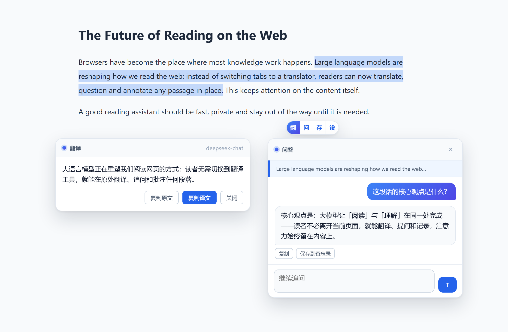
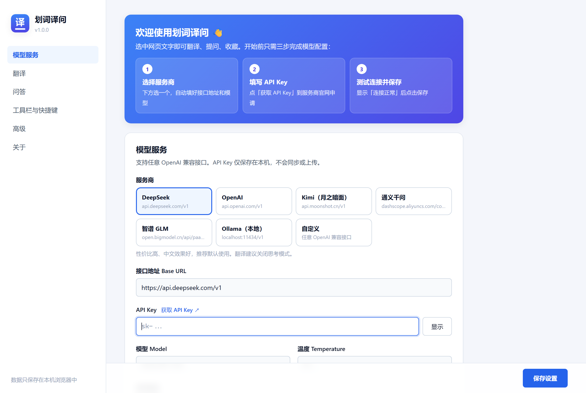
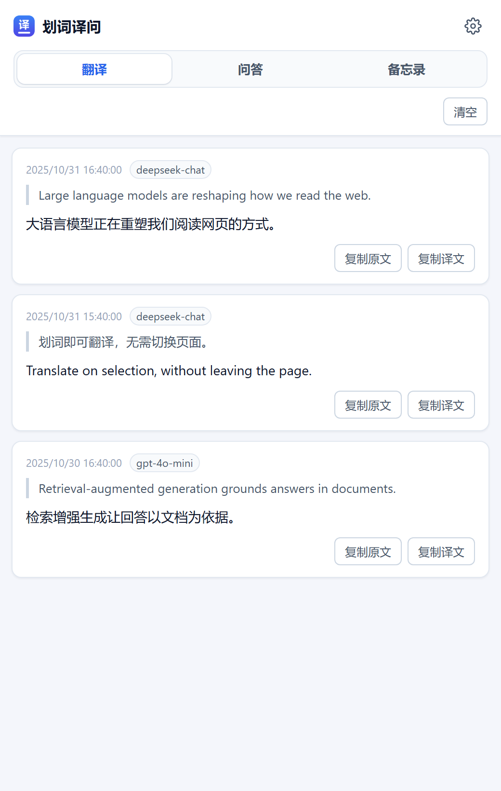

<div align="center">


# 划词译问 SelectLingo

**选中网页文字，一键 AI 翻译、追问与收藏 —— 不离开当前页面，数据只存本机。**

[](CHANGELOG.md)
[](https://developer.chrome.com/docs/extensions/mv3/intro/)
[](#-安装)
[](tsconfig.json)
[](LICENSE)

[安装](#-安装) · [使用](#-使用) · [常见问题](#-常见问题) · [隐私](#-隐私与安全) · [开发](#-开发)



</div>

---

## ✨ 功能

| | 功能 | 说明 |
|---|---|---|
| 🖱️ | **划词工具栏** | 选中文字后浮出「翻 · 问 · 存 · 设」，也支持右键菜单与快捷键 `Alt+T` |
| 🌐 | **AI 翻译** | 流式输出，首字秒出；选中目标语言文字时自动反向翻译；同文同模型命中缓存 |
| 💬 | **就选中内容提问** | 围绕选中段落多轮追问，会话保存在侧边栏，可随时继续 |
| 📝 | **一键收藏** | 选中文字或 AI 回答一键存入备忘录，可搜索、编辑、导出 Markdown |
| 🤖 | **任意模型** | 内置 DeepSeek、OpenAI、Kimi、通义千问、智谱 GLM、Ollama 预设，也支持任意 OpenAI 兼容接口 |
| 🧠 | **思考模式** | 支持 DeepSeek V4 等模型的思考开关；推理过程不进入历史与缓存 |
| 🔒 | **隐私优先** | 请求由浏览器直连你配置的服务，不经过任何第三方服务器；API Key 只存本机、不参与同步 |
| 🎨 | **精致界面** | 统一设计规范，浅色 / 深色自动切换；Shadow DOM 隔离，不受网页样式干扰 |

<table>
  <tr>
    <td width="62%"></td>
    <td></td>
  </tr>
  <tr>
    <td align="center">设置页：选择服务商即自动填好接口与模型</td>
    <td align="center">侧边栏：翻译、问答、备忘录统一管理</td>
  </tr>
</table>

## 📦 安装

### 从 Releases 安装（推荐）

1. 在 [Releases](https://github.com/lizhongv/edge-translate-extension/releases/latest) 下载 `selectlingo-vX.Y.Z.zip` 并解压。
2. 打开 `edge://extensions/`（Chrome 为 `chrome://extensions/`），开启 **开发人员模式**。
3. 点击 **加载解压缩的扩展**，选择解压后的文件夹。
4. 安装后自动打开欢迎页，按引导完成配置。

### 从源码构建

```bash
git clone https://github.com/lizhongv/edge-translate-extension.git
cd edge-translate-extension
npm ci
npm run build        # 产物在 dist/，按上面第 2～3 步加载 dist 目录
```

> 需要 Node.js 20 及以上。

## 🚀 使用

**第一步：配置模型（只需一次）**
设置页选择服务商 → 填写 API Key（点「获取 API Key」到官网申请）→ 点 **测试连接** → **保存设置**。

**第二步：在任意网页选中文字**

| 操作 | 方式 |
|---|---|
| 翻译 | 点工具栏「翻」，或右键「划词译问 → 翻译选中内容」，或按 `Alt+T` |
| 提问 | 点「问」，在卡片中多轮追问；会话保存在侧边栏「问答」 |
| 收藏 | 点「存」，或在 AI 回答下点「保存到备忘录」 |
| 查看记录 | 点浏览器工具栏中的扩展图标，打开侧边栏 |

快捷键可在 `edge://extensions/shortcuts` 修改，问答快捷键可自行绑定。

## ❓ 常见问题

<details>
<summary><b>需要付费吗？</b></summary>

扩展本身免费、开源。翻译与问答调用的是你自己的模型服务，按服务商的价格计费；DeepSeek、智谱 glm-4-flash 成本很低，本地 Ollama 完全免费。选中超长文字时会先提醒确认，避免误操作产生费用。
</details>

<details>
<summary><b>提示「API Key 无效」或连接失败？</b></summary>

在设置页点「测试连接」查看具体原因：确认接口地址与服务商一致、Key 没有多余空格、账户有余额。OpenAI 在国内网络通常需要代理。
</details>

<details>
<summary><b>某些网页选中后没有工具栏？</b></summary>

- 浏览器内置页面（`edge://`、扩展商店等）禁止扩展运行。
- 输入框、可编辑区域中不会出现工具栏，以免打扰输入。
- 网站禁止选中文字时，可在设置「高级」中开启「强制页面文字可选」，刷新页面后生效。
- 浏览器内置 PDF 阅读器、canvas 渲染的文字暂不支持。
</details>

<details>
<summary><b>数据保存在哪里？换电脑会同步吗？</b></summary>

历史、问答、备忘录与 API Key 只保存在本机浏览器。非敏感的偏好设置（语言、开关等）会随浏览器账号同步，API Key 与自定义请求头不会同步。
</details>

## 🔐 隐私与安全

- **无服务器**：扩展没有后端，不收集、不上传任何数据；划词内容只发送给你自己配置的模型服务。
- **本机存储**：API Key、历史、备忘录保存在 `chrome.storage.local`，卸载扩展即全部清除。
- **最小打扰**：内容脚本只在你选中文字并点击按钮时才发起请求。

完整说明见 [隐私政策](PRIVACY.md)，安全问题请按 [SECURITY.md](SECURITY.md) 报告。

## 🛠 开发

| 命令 | 说明 |
|---|---|
| `npm run dev` | 开发模式（热更新），加载 `dist/` 调试 |
| `npm run build` | 生产构建 |
| `npm run check` | 类型检查 + 代码检查 + 单元测试 |
| `npm run icons` | 重新生成图标（Python + Pillow） |
| `npm run screenshots` | 用演示数据渲染各界面截图（需先 build，Windows + Edge） |

- 架构说明：[docs/ARCHITECTURE.md](docs/ARCHITECTURE.md)
- 开发规范：[docs/DEVELOPMENT.md](docs/DEVELOPMENT.md)
- 应用商店上架素材：[docs/STORE_LISTING.md](docs/STORE_LISTING.md)

## 🗺 路线图

- [ ] 整页翻译（双语对照）
- [ ] 多套模型配置一键切换
- [ ] 自定义术语表
- [ ] 备忘录标签与分组
- [ ] 浏览器内置 PDF 阅读器划词

欢迎在 [Issues](https://github.com/lizhongv/edge-translate-extension/issues) 提建议，贡献方式见 [CONTRIBUTING.md](CONTRIBUTING.md)。

## 📄 许可证

[MIT](LICENSE) —— 可免费用于个人与商业用途。
